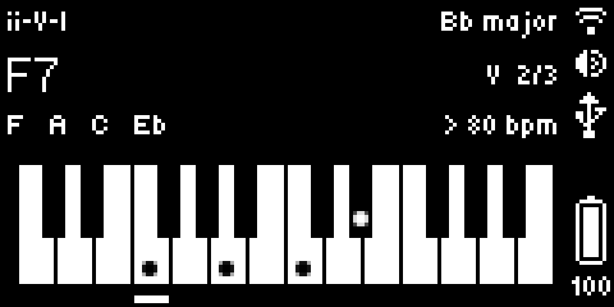

# Chord Pilot

A practice partner for musicians on your BUSY Bar. It shows you which chord to play and when to change, so you can practise with both hands on your instrument.




## What it is, in plain words

- A **chord** is a few notes played together. C, E and G played at the same time make a C chord.
- Most songs move through a short series of chords that comes back again and again. Musicians call these series **progressions**. A handful of them, such as the "two-five-one", appear in thousands of songs, especially in jazz.
- The same progression can start on any of the 12 notes of an octave. That starting note is called the **key**. Musicians practise each progression in all 12 keys, so that they can play a song whatever key it is in.

Chord Pilot does that practice with you: it shows the chord to play now and the one coming next, counts the beat, and moves to a new key after each round.

## How it works

1. Press **Start**. The bar counts you in for four beats: "in 4", "in 3", "in 2", "in 1".
2. The front shows the chord to play now in large letters, and the next chord in small letters on the right.
3. The line along the bottom fills up one segment per beat. When it is full, the chord changes.
4. After the last chord of the progression, it starts again in a new key. Twelve rounds later you have played it in every key.

Chord Pilot makes no sound: it shows the changes, and you play them.

## Reading the displays

**Front**

- **The chord name.** The letter is the chord's main note, its *root*: `C`, `F#`, `Bb`. What follows describes its sound:
  - `maj7`: major seventh, bright and soft
  - `m7`: minor seventh, mellow and a little sad
  - `7`: dominant seventh, tense; it wants to move on
  - `m7b5`: half-diminished, dark and unstable
- **The colour** says what the chord does in the progression, so you learn to hear it in every key:
  - **blue**: moves away from home
  - **orange**: builds tension that wants to resolve
  - **green**: home, where the tension resolves
  - **violet**: a softer stand-in for home
- **The small dots** show where you are in the progression.

**Back**

- The progression's name and the key, for example "ii-V-I" in "Bb major". The Roman numerals count steps from the key's home note: I is home and V is the fifth step.
- The chord name, and its notes written out: F7 is F, A, C and Eb.
- A keyboard with a dot on each key of the chord and a bar under its root. Even with no music training, you can play the chord by pressing the dotted keys on a piano.
- Whether it is playing (`>`) or paused (`||`), and the tempo in beats per minute.

## Controls

| Control | What it does |
| --- | --- |
| **Start** | Play or pause. Each start counts you in again. |
| **Wheel turn** | Change the key. The new key shows on the front for a moment. |
| **Wheel press** | Jump to the next chord. |
| **Hold the wheel** | Switch to the next progression. |
| **Back** | Exit. Your last key and progression are remembered. |

## Progressions

- **ii-V-I** (two-five-one), major: the most common chord series in jazz
- **minor ii-V-i**: the same movement in a minor, darker key
- **I-vi-ii-V**: a loop heard in countless pop songs and jazz standards

## Settings

Change them in the BUSY Bar's settings for the app. They apply the next time the app starts.

| Setting | Choices | Default |
| --- | --- | --- |
| Tempo (BPM) | 40 to 200 beats per minute | 80 |
| Beats per chord | 2, 4 (one bar) or 8 (two bars) | 4 |
| After each round | Move up a fourth (C, F, Bb...), move up a semitone, or stay in the same key | Up a fourth |

Moving up a fourth is the order musicians traditionally practise in. It goes through all 12 keys and back to the start.

## Build and install

```sh
npm ci
npm run build         # dist/app.luiar.chord-pilot.tgz
npm run app:install   # on a BUSY Bar connected over USB
```

Or open the folder in BUSY Bar Emulator and press Refresh.

Made for [BUSY Bar](https://busy.app).
